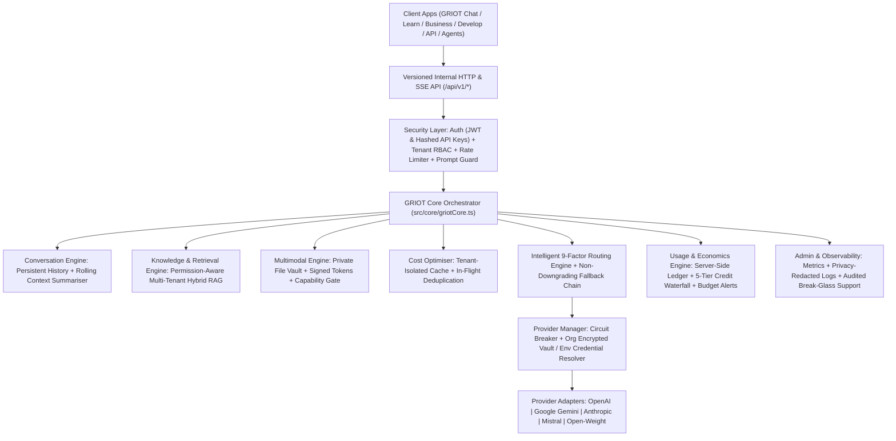

# GRIOT AI — Phase 1 Architecture & Deployment Guide

## 1. Executive Overview

**GRIOT AI** is the central AI intelligence and model orchestration infrastructure platform under **Avantage Group**, engineered to power:

1. **GRIOT Chat** — Consumer and enterprise conversational intelligence comparable in simplicity and responsiveness to Google Gemini.
2. **GRIOT Learn** — Adaptive learning, tutoring, and curriculum intelligence.
3. **GRIOT Business** — Enterprise knowledge retrieval, document analysis, and operational decision support for Avantage Group companies and African businesses.
4. **GRIOT Develop** — Coding assistance, architecture synthesis, and developer tooling.
5. **GRIOT API** — Unified, multi-provider AI gateway and billing engine for African developers and enterprises.
6. **GRIOT Agents** — Autonomous multi-step workflow execution with governed tool invocation.

---

## 2. Modular System Architecture



---

## 3. Core Subsystem Directory Map

| Module | File Path | Responsibility |
| :--- | :--- | :--- |
| **Domain Types** | `src/types/domain.ts` | Canonical TypeScript interfaces for models, providers, routing, tenancy, multimodal, and economics |
| **Configuration** | `src/config/env.ts` | Environment loader, secret validator, and non-exposing credential inspector |
| **Database Engine** | `src/db/database.ts` | Relational persistence engine (`node:sqlite` WAL + savepoint nested transactions) and schema migration loader |
| **SQL Migrations** | `migrations/001_griot_phase1_sqlite.sql`<br>`migrations/001_griot_phase1_postgres.sql` | Complete relational schemas for SQLite (local/edge/testing) and PostgreSQL + `pgvector` (Supabase production) |
| **Cryptography & Vault** | `src/security/crypto.ts` | `scrypt` password hashing, SHA-256 API key hashing, AES-256-GCM secret vault, HMAC-SHA256 JWT & file tokens |
| **Auth & RBAC** | `src/security/auth.ts` | Bearer JWT & `X-Griot-Api-Key` authentication, strict tenant/workspace isolation, and role-to-scope mapping |
| **Prompt & Tool Guard** | `src/security/promptGuard.ts` | Untrusted prompt/document sanitizer, prompt injection detector, XML context boundary wrapper, tool call validator |
| **Rate Limiter** | `src/security/rateLimiter.ts` | Sliding-window rate limiting per API key, User, Organisation, and IP with automated abuse lockout |
| **Audit & Retention** | `src/security/auditAndRetention.ts` | Immutable audit trail, organisation data retention purge, and account deletion/anonymisation workflow |
| **Multi-Tenancy** | `src/tenancy/tenantService.ts` | Users, Organisations (Avantage Group internal + external tenants), Workspaces, Memberships, API Keys, Org Vault |
| **Model Registry** | `src/registry/modelRegistry.ts`<br>`config/models.registry.json` | Configurable JSON model metadata loader, hot-reloader, and database runtime override merger |
| **Provider Adapters** | `src/providers/*.ts` | Official protocol adapters for OpenAI, Google Gemini, Anthropic, Mistral, and Open-Weight compatible endpoints |
| **Intelligent Router** | `src/routing/routingEngine.ts` | 9-factor task classifier, hard capability/modality/context/reasoning filter, scorer, and safe fallback builder |
| **Multimodal Engine** | `src/multimodal/multimodalEngine.ts` | Private file storage vault, signed internal references, capability verifier, decoupled extraction/voice adapters |
| **Knowledge Engine** | `src/knowledge/knowledgeEngine.ts` | Permission-verified ingestion, semantic overlap chunking, embeddings, hybrid vector + lexical RAG, citations |
| **Economics Engine** | `src/economics/usageEngine.ts`<br>`src/economics/costOptimizer.ts` | Server-side token/cost calculation, 5-tier credit waterfall, user/org/key spending limits, caching, deduplication |
| **Conversation Engine** | `src/conversations/conversationEngine.ts` | Persistent conversations, message metadata, streaming, interrupted response recovery, rolling context summariser |
| **Observability & Admin** | `src/admin/observabilityService.ts` | Operational metrics, latency percentiles, default conversation redaction, and audited break-glass investigation |
| **GRIOT Core** | `src/core/griotCore.ts` | Central intelligence orchestrator coordinating all subsystems |
| **HTTP & SSE Server** | `src/api/httpServer.ts` | Versioned `/api/v1/*` REST and Server-Sent Events (`text/event-stream`) server |

---

## 4. Intelligent 9-Factor Routing & Safe Failover

The `RoutingEngine` (`src/routing/routingEngine.ts`) evaluates every request across 9 dimensions:

1. **Task Classification**: `simple_writing`, `summarization`, `classification_extraction`, `complex_reasoning`, `coding`, `image_understanding`, `document_analysis`, `audio_processing`, `video_understanding`, or `general_chat`.
2. **Required Capabilities**: Hard filter ensuring the model supports every required capability (`vision`, `coding`, `reasoning`, `document_analysis`, `audio_understanding`, `video_understanding`, `json_mode`, `tool_use`, `streaming`, `long_context`).
3. **Reasoning Complexity**: `low`, `medium`, or `high`. High-complexity requests enforce a hard floor (`reasoningTier` must be `advanced` or `deep_reasoning`).
4. **Input Size**: Total token estimate (prompt + bounded history + attachments + RAG chunks) plus `maxOutputTokens` must fit within `model.contextWindow`.
5. **Output Requirements**: Enforces JSON output (`json_mode`), tool declarations (`tool_use`), and output token ceilings.
6. **Latency**: Matches `fast`, `medium`, or `slow` latency classes against request hints and organisation optimization modes.
7. **Cost**: Scores models using published input/output per-1M pricing, routing simple tasks to affordable models (`$0.10–$0.15 / 1M`) while reserving reasoning models for complex workloads.
8. **Provider Availability**: Consults `ProviderManager` live circuit breaker and credential availability.
9. **User & Organisation Preferences**: Honours `preferredProviders`, `blockedProviders`, `preferredModels`, and `costOptimizationMode` (`balanced`, `cost_first`, `quality_first`, `latency_first`).

### Non-Downgrading Fallback Guarantee
Every model placed in `fallbackChain` passes the **exact same hard constraint validator** as the primary model. If a provider fails and no alternative model can satisfy the request's required modalities, capabilities, context window, or reasoning floor, GRIOT refuses to silently downgrade and returns a clear `ROUTING_CONSTRAINT_UNSATISFIED` (`HTTP 422`) or upstream provider error.

---

## 5. Deployment Instructions

### Prerequisites
- **Node.js**: `>= 22.6.0` (verified on `v22.23.5` with native TypeScript execution and built-in `node:sqlite`).
- **Database**:
  - **Local / Edge / Single-Node**: Built-in SQLite WAL database (`GRIOT_SQLITE_PATH=./data/griot.db`).
  - **Multi-Node Production (Supabase / PostgreSQL)**: Apply `migrations/001_griot_phase1_postgres.sql` to your PostgreSQL + `pgvector` instance and set `GRIOT_DATABASE_URL`.

### Step-by-Step Setup

1. **Configure Environment Variables**:
   Copy `.env.example` to `.env` and populate secrets:
   ```powershell
   Copy-Item .env.example .env
   ```
   In production (`GRIOT_ENV=production`), `GRIOT_JWT_SECRET`, `GRIOT_VAULT_MASTER_KEY`, and `GRIOT_FILE_SIGNING_SECRET` are strictly mandatory (minimum 32 random bytes each).

2. **Configure Provider API Keys**:
   Set one or more provider credentials in `.env` (or per-organisation via `PUT /api/v1/organisations/current/provider-credentials`):
   - `OPENAI_API_KEY`
   - `GEMINI_API_KEY`
   - `ANTHROPIC_API_KEY`
   - `MISTRAL_API_KEY`
   - `OPEN_WEIGHT_API_KEY` and `OPEN_WEIGHT_BASE_URL`

3. **Run Typechecking & Automated Tests**:
   ```powershell
   npm test
   npm run typecheck
   ```

4. **Start the GRIOT Core Server**:
   ```powershell
   npm start
   ```
   The server listens on `http://127.0.0.1:4100` (configurable via `GRIOT_HOST` and `GRIOT_PORT`) and exposes `/api/v1/health`.
