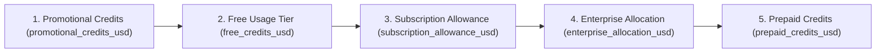

# GRIOT AI — Usage, Economics & Cost Optimisation Engine

## 1. Server-Side Usage & Cost Accounting Principles

1. **Never Trust Client-Side Calculations**: All token counts (`inputTokens`, `outputTokens`, `cachedInputTokens`), processing duration (`durationMs`), and USD cost calculations are performed strictly on the server inside `UsageAndEconomicsEngine` (`src/economics/usageEngine.ts`).
2. **Actual Provider Cost Priority**:
   - Whenever an upstream provider returns `actualProviderCostUsd`, GRIOT sets `billableCostUsd = actualProviderCostUsd` (`costSource = 'actual_provider'`).
   - Otherwise, GRIOT computes `estimatedCostUsd` from the Model Registry's published per-1M pricing (`costSource = 'registry_pricing'`), accurately accounting for discounted cached input tokens:
     $$\text{Estimated Cost (USD)} = \frac{T_{\text{uncached\_in}}}{10^6} \cdot P_{\text{in}} + \frac{T_{\text{cached\_in}}}{10^6} \cdot P_{\text{cached\_in}} + \frac{T_{\text{out}}}{10^6} \cdot P_{\text{out}}$$
   - Responses served from GRIOT's tenant-isolated response cache incur `$0.00` billable cost (`costSource = 'cached_zero'`).

---

## 2. Five-Tier Credit Bucket Waterfall

Every organisation's `billing_accounts` record separates credits into five distinct buckets. When a request incurs a `billableCostUsd`, GRIOT deducts across the buckets atomically inside a database transaction in the following priority order:

Every `usage_ledger` row records the exact `credits_breakdown_json` (`promotionalUsd`, `freeUsd`, `subscriptionUsd`, `enterpriseUsd`, `prepaidUsd`) consumed by that request.

---

## 3. Multi-Level Spending Limits & Runaway Cost Prevention

Before any upstream model call is dispatched, `assertWithinSpendingLimits()` checks four independent gates:

1. **Total Available Credits**: Rejects the request (`HTTP 402 BUDGET_OR_CREDIT_LIMIT_EXCEEDED`, `scope: 'insufficient_credits'`) if the sum of the 5 credit buckets cannot cover the projected request cost.
2. **Organisation Monthly Budget Limit** (`billing_accounts.monthly_budget_limit_usd`): Rejects (`scope: 'organisation'`) if cumulative organisation spend plus projected cost exceeds the monthly ceiling.
3. **User Spending Limit** (`organisation_members.spending_limit_usd` / `users.spending_limit_usd`): Rejects (`scope: 'user'`) if the user's cumulative spend in the organisation exceeds their ceiling.
4. **API-Key Spending Limit** (`api_credentials.spending_limit_usd`): Rejects (`scope: 'api_key'`) if cumulative spend attributed to that API key exceeds its ceiling.

### Automated Budget Alerts
When cumulative organisation spend reaches `alert_threshold_percent` (default `80%`) of `monthly_budget_limit_usd`, an alert is automatically persisted in `budget_alerts` and surfaced in `/api/v1/usage`.

---

## 4. Cost Optimisation Mechanisms (`src/economics/costOptimizer.ts`)

1. **Intelligent Task-to-Price Routing**: Simple writing, greeting, summarization, and classification tasks are routed to high-speed economy models (`$0.10–$0.15 / 1M` input tokens), reserving higher-cost reasoning models for complex reasoning and architecture tasks.
2. **Bounded Context Window & Rolling Summarisation**: `ConversationEngine.buildBoundedContextWindow()` compacts older conversation turns into a concise rolling summary (`summary_context`), preventing quadratic token growth on long conversations.
3. **Tenant-Isolated Eligible Response Caching**: Low-temperature (`temperature <= 0.3`) tool-free requests are fingerprinted with `SHA-256(orgId + modelId + messages + temperature + responseFormat)`. Cache hits return immediately at `$0.00` upstream cost and never cross tenant boundaries.
4. **In-Flight Request Deduplication**: Identical concurrent requests within the same tenant coalesce onto a single upstream promise, preventing duplicate token charges on retry storms.
5. **Self-Hosted Open-Weight Break-Even Analyzer**: `evaluateSelfHostingEconomics()` compares monthly cloud token spend against dedicated GPU infrastructure cost, preventing premature self-hosting while enabling zero-code transition to the `open_weight` adapter once volume justifies it.
