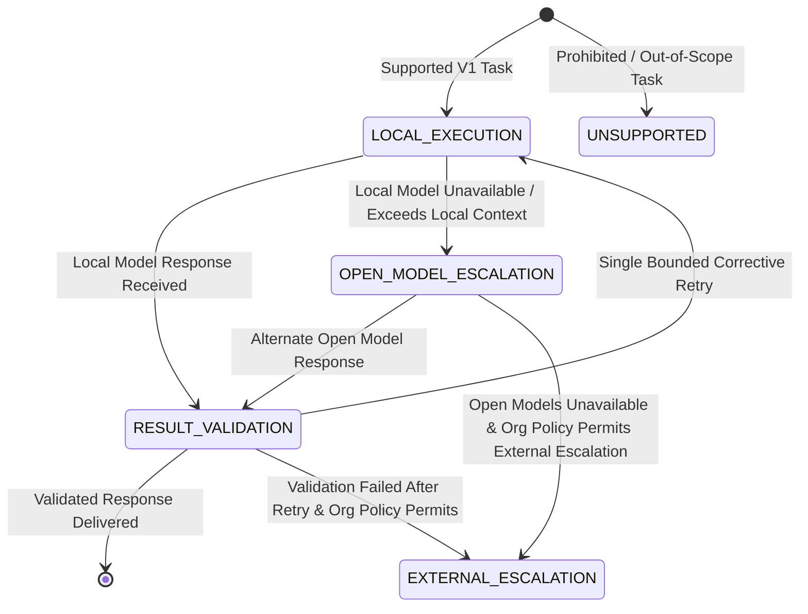

# GRIOT AI — V1 Task Routing, Result Validation & Guided Builder Workflow

## 1. V1 Execution States (`src/routing/v1TaskRouter.ts`)

GRIOT V1 implements a deterministic 5-state execution lifecycle for every AI request:

| State | Meaning |
| :--- | :--- |
| **`LOCAL_EXECUTION`** | Routes the request to the lowest-cost eligible local open-weight model running on Ollama (`open_weight:qwen2.5-3b` or `open_weight:qwen2.5-1.5b`). |
| **`OPEN_MODEL_ESCALATION`** | Escalates to a secondary open-weight model when the primary local model is unavailable or lacks sufficient context/capability. |
| **`EXTERNAL_ESCALATION`** | Escalates to a configured external cloud provider **only** when local/open models cannot fulfill the request **and** the organisation's data-sharing policy explicitly permits external transfer (`allowExternalProviderEscalation: true`) with valid credentials. |
| **`RESULT_VALIDATION`** | Runs `ResultValidationEngine` (`src/validation/resultValidator.ts`) to verify non-empty output, JSON syntax, required schema fields, required sections, classification labels, or code blocks before returning to the customer. |
| **`UNSUPPORTED`** | Safely rejects out-of-scope or unsafe V1 tasks (e.g., 4K video rendering, autonomous live financial trading execution, cyber exploitation, or inputs exceeding 120,000 tokens) with `HTTP 422 ROUTING_CONSTRAINT_UNSATISFIED` without invoking a model. |

---

## 2. Supported V1 Task Categories

The V1 Task Router (`V1TaskRouter.classifyV1Task`) classifies requests into 8 supported V1 categories:

1. **`general_conversation`** — Everyday questions, greetings, and dialogue.
2. **`writing_and_rewriting`** — Professional emails, memos, proposals, announcements, and tone polishing.
3. **`summarisation`** — Condensing documents, reports, and long text into executive summaries.
4. **`explanations_and_learning`** — Teaching concepts across entrepreneurship, financial education, engineering, technology, and personal development (**GRIOT Learn**).
5. **`text_classification`** — Sentiment analysis, ticket categorization, and label assignment.
6. **`structured_data_extraction`** — Parsing unstructured text into validated JSON objects with required schema fields.
7. **`basic_reasoning`** — Step-by-step comparisons, pros/cons evaluation, and logical deductions.
8. **`basic_coding_assistance`** — Code generation, function implementation, debugging, and refactoring (**GRIOT Develop**).

---

## 3. Guided Build Workflow Engine (`src/builder/guidedBuildEngine.ts`)

For **"BUILD WITH GRIOT"**, GRIOT uses a deterministic 12-state workflow engine (never a single oversized prompt):

1. `IDEA_CAPTURE` — Captures the user's plain-language project description and objective.
2. `REQUIREMENTS_DISCOVERY` — Extracts core features and presents at most 3 essential clarifying questions.
3. `PROJECT_CLASSIFICATION` — Classifies into `website`, `web_application`, `mobile_application`, `automation`, `business_system`, `ai_tool`, or `other`.
4. `TOOL_RECOMMENDATION` — Consults `BuilderToolRegistry` (`config/builder.tools.json`) to recommend the **simplest suitable tool** (**Lovable**, **Google Antigravity**, **Replit**, or **n8n / Make**) based on project category, user skill level, and budget.
5. `PROJECT_SPECIFICATION` — Generates a structured MVP specification and runs automated **Plan Quality Control** (`runPlanQualityControl`).
6. `BUILD_PLAN` — Breaks the project into sequential, manageable stages.
7. `ACTIVE_STEP` — Presents the current stage's beginner-friendly (or technical) instruction card and copyable prompt.
8. `USER_EXECUTION` — User executes the copyable prompt inside the recommended external tool.
9. `RESULT_REVIEW` — User submits what happened (`POST /api/v1/builder/projects/:id/submit-result`).
10. `TROUBLESHOOTING` — If the user reports an error (`POST /api/v1/builder/projects/:id/report-error`), GRIOT classifies the root cause and generates a targeted **Corrective Fix Prompt**.
11. `STEP_APPROVAL` — Approves the verified step, saves project progress, and unlocks the next step.
12. `PROJECT_COMPLETION` — Marks all stages complete with a final verification and publishing checklist.
